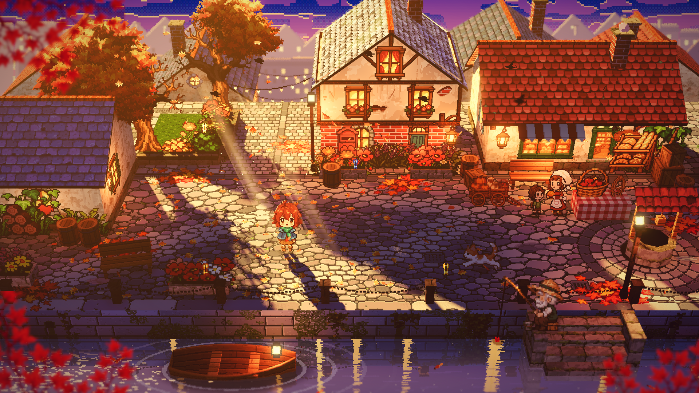

# hd2d-fable

像素風美術＋即時 3D 光影（HD-2D 類型）的場景測試：一個原創的「黃昏運河小鎮」，只做場景與光影，沒有玩法。

用來測試 AI 編碼代理（Claude Fable 5.2）能把這類畫面做到什麼程度，以及怎麼評分才可信。

## 版本

| 資料夾 | 說明 |
|---|---|
| `godot_pilot/` | 目前最佳版本：33° 俯角箱庭＋手修過的角色與素材（Godot 4.7.1） |
| `godot_diorama/` | 俯角箱庭版（素材手修之前） |
| `godot/` | 較早的平視鏡頭 Godot 版 |
| `web/` | three.js 版 |

## 啟動

    godot --path godot_pilot -f

網頁版：在 `web/` 執行 `npm install && npm run dev`。

## 文件

- [`BUILD_PROCESS.md`](BUILD_PROCESS.md)：完整建置流程、素材做法、評分方法與教訓。
- [`BRIEF.md`](BRIEF.md)：原始規格與驗收項目。

## 素材來源

- 場景、建築、角色皆為原創。
- 貼圖、角色點陣圖與 `target/` 的概念圖，是用 OpenAI codex CLI 生成後，再以腳本還原成點陣並逐點手修；部分貼圖由 Python 腳本程序化產生。
- 程式碼、shader 與素材處理腳本由 Claude（Anthropic）撰寫。
- 評分時用來比對的商業遊戲截圖不包含在此專案中。
